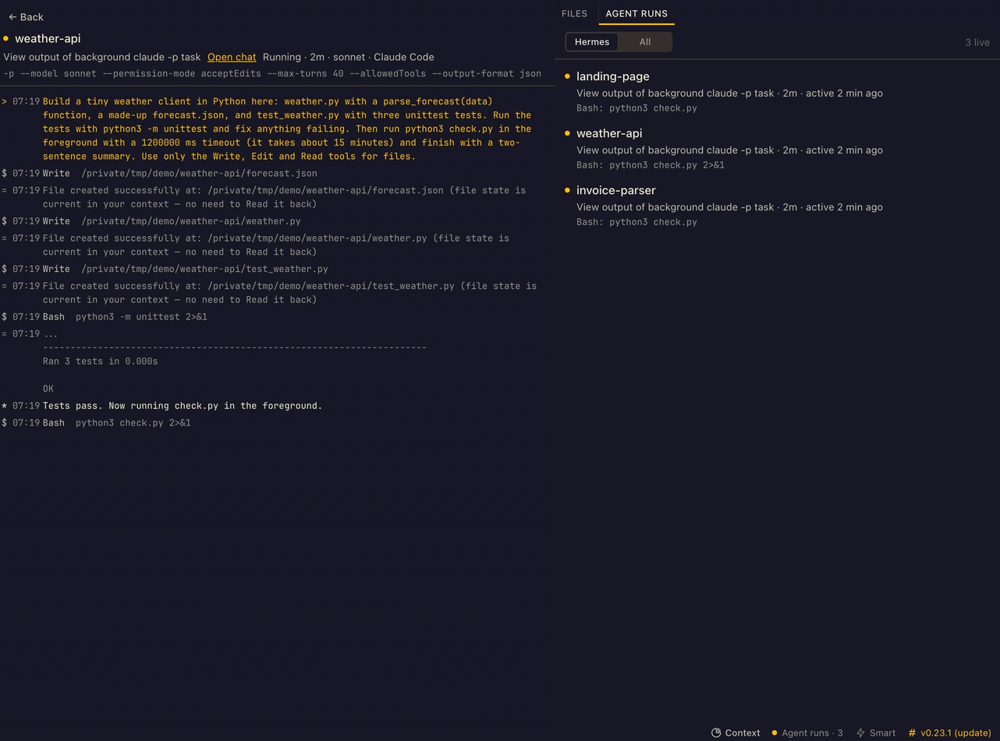
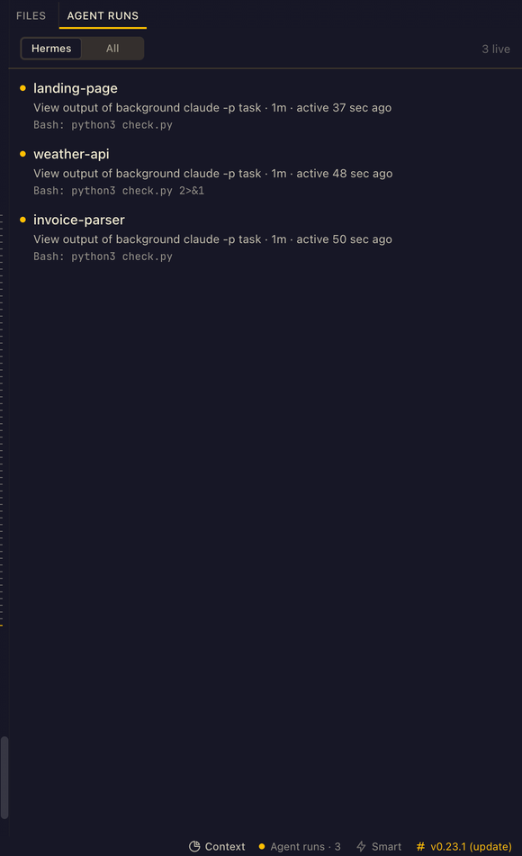
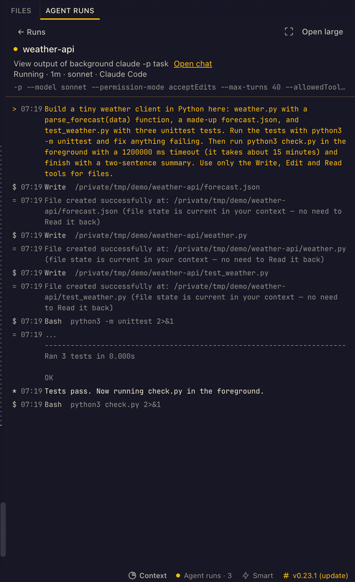

[](https://hermes-agent.nousresearch.com/marketplace/agent-runs)
[](https://github.com/0sahil/hermes-agent-runs/actions/workflows/ci.yml)
[](https://github.com/0sahil/hermes-agent-runs/releases/latest)
[](plugin.yaml)
[](LICENSE)

[Install](#install) · [What you see](#what-you-see) · [How it finds runs](#how-it-finds-runs) · [Settings](#settings) · [FAQ](#faq)

A pane in the [Hermes](https://github.com/NousResearch/hermes-agent) desktop app that lists the
coding-agent runs on your computer and shows what each one is doing, live. It is made for the runs
nobody is watching: the `claude -p` a Hermes chat or cron job started in the background.

It finds runs by itself. You don't start the agent in a special way, add flags, install hooks or run
a setup step. It only reads: it never sends anything to a run and never stops one.

An unofficial community plugin; not made, reviewed or endorsed by the Hermes project or Anthropic.




## Requirements

- Hermes Desktop **0.23.1** or newer, on macOS, Linux or Windows.
- A coding agent that the plugin supports (see [Supported agents](#supported-agents)).

## Install

Agent Runs is listed in the [Hermes plugin catalog](https://hermes-agent.nousresearch.com/marketplace/agent-runs):

```sh
hermes plugins install agent-runs --enable
```

Or in Hermes Desktop: **Capabilities → Plugins**, search for **Agent Runs**, and install.

This installs the commit the catalog reviewed, which can trail this repository's `main`.
`hermes plugins update agent-runs` moves it to the next reviewed version.

To run the newest code before it reaches the catalog (same plugin, newest `main`, not
catalog-reviewed), install from this repository instead:

```sh
hermes plugins install 0sahil/hermes-agent-runs --enable
```

Then:

1. In **Settings → Capabilities → Plugins**, turn on the **Desktop** switch on the Agent Runs row
   (the pane). The **Agent** switch (the backend that finds the runs) is on after `--enable`.
2. Restart the gateway once (`hermes gateway restart`) so Hermes loads the backend. Do it between
   chats: a restart ends the turn that is running.
3. Open the **Agent Runs** tab next to **Terminal**, or press ⌘K and run **Show agent runs**.

## What you see

**Where it is.** Agent Runs arrives as a tab next to **Terminal**, so it has a tab you can drag
anywhere in the layout; it stays where you put it. If the terminal is not in your layout, it joins
the right sidebar instead.

**The list.** Every run, newest activity first, with:

- a status dot: **running** (it wrote something recently), **waiting** (an interactive session
  waiting for you), **quiet** (alive but silent for a while, for example during a long build), or
  **finished** (the process has ended; finished runs stay below the live ones, dimmed, for a few
  hours);
- the project folder it runs in;
- where it was started from: the Hermes chat's title, **Hermes cron**, **Terminal**, or the IDE
  (**VS Code**, **Cursor**, **PyCharm**, ...);
- how long it has run, when it was last active, and its latest action in one line.

The switch at the top chooses between **Hermes** (runs started by Hermes chats and cron jobs, the
default) and **All** (every run on this computer).

 

**A run.** Click a run to follow its log as it happens: the prompt, what the agent says, each tool
call (the command it runs, the file it reads or edits, the pattern it searches) and the start of
each result, plus errors, interruptions and compactions. The log follows new lines while you are at
the bottom and stops when you scroll up. For a run started from a Hermes chat, **Open chat** takes
you to that chat.

**In a narrow sidebar** (under about 420 px) the run view is compact: each log entry is one line
(kind, time, what happened); click it, or press Enter or Space, to open the whole text in place.
The header shows the folder and status, then where the run came from and how long it has run;
the model and the command line are under **Details**.

**Open large** (the button at the top of a run) opens that run full size in the main area, with the
same live log, and the pane goes back to its run list. **Back** returns to where you were.

**The status bar** shows "Agent runs · 2" while runs are live (in the default view); click it to
open the pane.

## Settings

Under **Settings → Plugins → Agent Runs**:

| Setting | Default | What it does |
| --- | --- | --- |
| Show by default | `hermes` | The view the pane and the status-bar count use: `hermes` or `all`. |
| Show Hermes' own model calls | off | When Hermes uses your Claude subscription as its model, each answer is a short Claude Code process that saves no session. They are hidden unless this is on. |
| Show thinking | off | Include the agent's thinking in a run's log, when the transcript has it. |
| Keep finished runs (hours) | 6 | How long a run stays in the list after it ends. |
| Quiet after (minutes) | 10 | A live run that has written nothing for this long shows as quiet. |

## Supported agents

| Agent | Supported |
| --- | --- |
| Claude Code (native install, npm, Windows) | Yes |
| Codex, opencode, Gemini CLI, others | Planned |

Every agent-specific piece sits behind a small adapter
([`dashboard/adapters/claude.py`](dashboard/adapters/claude.py)), so adding an agent does not touch
the rest. See [CONTRIBUTING.md](CONTRIBUTING.md).

## How it finds runs


For Claude Code:

1. **Processes.** It looks for `claude` processes, whatever their process name (a native install is
   named after its version), npm installs (`node .../@anthropic-ai/claude-code/cli.js`) and
   `claude.exe` on Windows. The Claude desktop app is not a run and is skipped.
2. **The session.** A running Claude Code records its session in `~/.claude/sessions/<pid>.json`;
   the plugin reads it (checking the start time, so a reused process id is not mixed up), else
   `--session-id` / `--resume` on the command line, else the newest log written in the run's folder
   since it started. The log is then found by session id under `~/.claude/projects/`. A
   `CLAUDE_CONFIG_DIR` set for a run is honoured.
3. **Where it came from.** Hermes marks the processes its tools start with its own environment
   variables (the chat or cron session), which survive detaching. Otherwise the plugin looks at the
   process's parents for a known terminal, IDE or Hermes.

## What the plugin does on your computer

- **Reads the process list**, including the command line of every process (to recognise agents) and
  the environment and working folder of agent processes only (to tell where a run came from and
  which config folder it uses). Environment values never leave the backend; the pane gets a summary
  of the command line with flags only (values only for `--model`, `--effort`,
  `--permission-mode`, `--max-turns` and the input/output formats). The prompt is never part of it.
- **Reads Claude Code's files, read-only:** `~/.claude/sessions/<pid>.json` and the session logs in
  `~/.claude/projects/` (or the same folders under a run's `CLAUDE_CONFIG_DIR`). It never opens the
  `.key` files beside the session files and never writes into `~/.claude`.
- **Writes only** `plugin-data/agent-runs/runs.json` in the active profile's Hermes home: the runs it
  has seen recently (id, folder, origin, start and last activity, log location), so finished runs
  stay listed after a gateway restart. Entries are removed after **Keep finished runs**.
- **Asks Hermes** for your chat titles (the gateway's session list and the desktop's list of saved
  chats) to label runs started from a chat.
- **No network, no programs, no model calls.** It runs no subprocesses and sends nothing anywhere.
- **Shows what the agent does.** The log view shows prompts, the agent's messages, commands and
  the start of tool output, as Claude Code saved them. Anyone who can see your Hermes window sees
  them.

## Limits

- Same computer only: runs inside Docker containers, virtual machines or over SSH are not visible.
- Runs started with session saving off (`--no-session-persistence`) have no log to show; they are
  listed with "no live log".
- Runs of another user account are listed only as far as the operating system lets the plugin read
  them.
- Subagents a run starts are not shown as separate runs yet; their work appears as the parent's
  tool calls.
- Only runs the plugin saw while they were running are listed: runs that ended before it was
  installed (or while the gateway was off) do not appear under **Finished**.

## FAQ

**A run is missing.** Check the switch at the top: the default view shows only runs started by
Hermes. If it is missing under **All** too, open an issue with how the agent was started.

**It says "no live log".** The run does not save its session (Hermes' own model calls and runs with
`--no-session-persistence`), or its log has not been written yet.

**The pane says the backend is not ready.** Restart the gateway once (`hermes gateway restart`) after
installing or updating the plugin, and check that the plugin is enabled (`hermes plugins list`).

**Can it stop a run or send it a message?** No. The plugin is read-only on purpose.

## Uninstall

```sh
hermes plugins remove agent-runs
```

To also delete what it remembered, remove `plugin-data/agent-runs` from your Hermes home.

## Contributing

Bug reports and pull requests are welcome; see [CONTRIBUTING.md](CONTRIBUTING.md). Report security
issues privately, as described in [SECURITY.md](SECURITY.md).

## License

[MIT](LICENSE). "Claude" and "Claude Code" are Anthropic's names, used here only to say which agent
the plugin works with.
